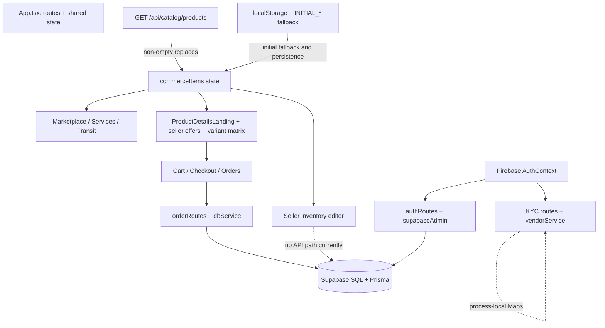

# PaikarMart Repository Audit Report

**তারিখ:** 2026-11-17  
**Branch:** `master` → `origin/codex/root-app`  
**Scope:** বর্তমান Git-tracked 268টি ফাইল; frontend, backend, shared/database packages, Supabase/Firestore/Storage rules, deploy config ও development documents। `.env`-এর secret value পড়া হয়নি। `PaikarMart-web-main/`, root `src/`, `node_modules/` ignored; এগুলো active build-এর অংশ নয়।

## Executive summary

Project-এর frontend build, frontend TypeScript, backend TypeScript এবং dependency audit পাস করেছে। `npm audit --audit-level=high`-এ vulnerability পাওয়া যায়নি। তবে compile pass-কে production-ready ধরা যাবে না: কয়েকটি public API ব্যক্তিগত order/prescription/chat data expose করে বা unauthorized mutation নেয়; KYC self-approval সম্ভব; seller inventory, KYC, messaging ও orders-এর গুরুত্বপূর্ণ অংশ memory/localStorage-এ সীমাবদ্ধ।

এই audit report তৈরির সময় application source fix করা হয়নি। নিচে priority-সহ fix sequence দেওয়া হয়েছে; আপনার অনুমোদনের পরেই code fix শুরু হবে।

## 1. যেসব ফাইল/নিয়ন্ত্রণ যাচাইয়ে ঠিক পাওয়া গেছে

এগুলো পুরো ফাইলের সব সম্ভাব্য behavior নিখুঁত—এমন নিশ্চয়তা নয়; নির্দিষ্ট security/build control-গুলো static review-তে সঠিক ছিল।

- [requireFirebaseAuth.ts](../apps/backend/middleware/requireFirebaseAuth.ts): Bearer Firebase ID token verify করে, revocation check করে এবং auth config না থাকলে fail-closed response দেয়।
- [firestore.rules](../firestore.rules): global default-deny, owner-bound user profile এবং admin document lookup আছে; client role update সীমাবদ্ধ।
- [storage.rules](../storage.rules): KYC documents owner-only, file size/MIME সীমা আছে; fallback deny আছে।
- [walletRoutes.ts](../apps/backend/wallet/walletRoutes.ts) ও [escrowRoutes.ts](../apps/backend/escrow/escrowRoutes.ts): durable ledger/payment callback না থাকায় financial mutations success দেখানোর বদলে fail-closed।
- [authRoutes.ts](../apps/backend/auth/authRoutes.ts): profile/address operations Firebase UID থেকে profile resolve করে; caller-supplied user ID authority নয়। তবে deployment-এ `supabaseAdmin` config প্রয়োজন।
- [.gitignore](../.gitignore): `.env*`, generated build/server files, legacy folder ও local previews ignore করে। `git ls-files '.env*'`-এ শুধু `.env.example` আছে; `.env` tracked নয়। Secret contents পরীক্ষা করা হয়নি।
- Frontend lint, production build, backend TypeScript check, dependency tree check সফল; dependency audit-এ 0 vulnerabilities।

## 2. Bug / security finding

Severity: **P0 Critical** = release blocker/security incident risk; **P1 High** = production feature/data integrity blocker; **P2 Medium** = correctness, UX বা maintenance risk।

| Priority | ফাইল | প্রমাণ ও প্রভাব |
|---|---|---|
| **P0** | [orderRoutes.ts](../apps/backend/orders/orderRoutes.ts#L64) | `GET /api/orders`, `GET /:id`, `GET /:id/track`-এ authentication বা guest tracking token নেই। List response-এ buyer name/phone/address-সহ order record যেতে পারে। `PATCH/PUT /:id/status`-ও auth ছাড়া status বদলায় এবং caller-এর `fallbackOrder` দিয়ে memory record বানাতে পারে ([লাইন 205](../apps/backend/orders/orderRoutes.ts#L205), [লাইন 262](../apps/backend/orders/orderRoutes.ts#L262))। Strict customer privacy ভঙ্গ হয়; order tracking/status tampering সম্ভব। |
| **P0** | [retailRoutes.ts](../apps/backend/retail/retailRoutes.ts#L581) | Prescription POST-এ Firebase auth নেই; `customerId`, নাম, phone, address, medicine notes ও `previewDataUrl` body থেকে নেয়। `GET /api/retail/prescriptions` auth ছাড়া সম্পূর্ণ in-memory prescription list ফেরায় ([লাইন 672](../apps/backend/retail/retailRoutes.ts#L672))। এটি medical/contact/location PII exposure। |
| **P0** | [messagingRoutes.ts](../apps/backend/messaging/messagingRoutes.ts#L162) | Conversations/thread GET এবং init/send routes-এ `requireFirebaseAuth` নেই। `/send` caller-supplied `senderId`, `senderName`, `role` গ্রহণ করে ([লাইন 243](../apps/backend/messaging/messagingRoutes.ts#L243))। অন্যের conversation পড়া, identity spoof ও message injection সম্ভব। Data-ও process memory-তে। |
| **P0** | [vendorRoutes.ts](../apps/backend/vendors/vendorRoutes.ts#L26), [vendorService.ts](../apps/backend/vendors/vendorService.ts#L265) | Authenticated user request body-র `autoApproveDemo` সরাসরি service-এ pass হয়। Service `autoApproveDemo === true` **অথবা শুধু NID length ≥10 ও registration number length ≥5** হলেই KYC `approved` করে; বাহ্যিক verification নেই ([লাইন 301](../apps/backend/vendors/vendorService.ts#L301))। তাই user নিজেই verified merchant tier পেতে পারে; “Zero Demo-Bypass Rule” ভঙ্গ। |
| **P1** | [orderRoutes.ts](../apps/backend/orders/orderRoutes.ts#L98) | Order endpoint client-supplied subtotal, delivery, tax, items ও payment method-কে authority ধরে; database price/stock পুনরায় resolve/decrement করে না। `orderId`-ও body থেকে নেয়। forged cheap order/oversell ও false payment status সম্ভব। |
| **P1** | [dbService.ts](../apps/backend/services/dbService.ts#L81), [schema.sql](../supabase/schema.sql#L272) | `insertStoredOrder()` `customer_id` পাঠায় না, অথচ SQL-এ `orders.customer_id` non-null FK। Supabase response-এর `{ error }` পরীক্ষা করা হয় না; service order write ব্যর্থ হলেও API memory order-কে success দেখাতে পারে ([orderRoutes.ts](../apps/backend/orders/orderRoutes.ts#L162))। |
| **P1** | [vendorService.ts](../apps/backend/vendors/vendorService.ts#L184), [vendorRoutes.ts](../apps/backend/vendors/vendorRoutes.ts#L26) | Store registry ও KYC queue `Map`/array-তে থাকে; DB write/read নেই। Process restart-এ submitted/approved KYC ও stores হারায়। Public store/analytics-ও এই in-memory registry-নির্ভর। |
| **P1** | [CommerceSubDashboard.tsx](../apps/frontend/src/portals/seller-central/components/CommerceSubDashboard.tsx#L133), [App.tsx](../apps/frontend/src/App.tsx#L460) | Product Editor-এর `onSave` শুধু App state-এ product যোগ করে; server API call নেই। App সেটি localStorage-এ sync করে, `seller_listings` বা `catalog_submissions`-এ নয়। অন্য user/device-এ listing যায় না, stock/variant/SKU backend truth হয় না। Editor সব preset combination-এর offer তৈরি করে না—শুধু first/default combination-এর একটি offer বানায়। |
| **P1** | [server.ts](../apps/backend/server.ts#L116), [dbService.ts](../apps/backend/services/dbService.ts#L49), [schema.sql](../supabase/schema.sql#L248) | Social post POST unauthenticated। Supabase insert-এ required `author_id` বাদ; SQL-এ সেটি non-null। `insertStoredPost()` error object ignore করে, ফলে DB write ব্যর্থ হলেও memory-তে success। |
| **P1** | [catalogRoutes.ts](../apps/backend/catalog/catalogRoutes.ts#L63) | Public catalog read service-role client ব্যবহার করে, কিন্তু query কেবল `is_active=true` ও `store.status='active'` filter করে; `store.is_verified`, `store.kyc_status`, `master_product.is_verified` filter নেই। Unverified listing public feed-এ যেতে পারে। Query-তে `variant_options`/`variant_offers` select-ও নেই, তাই mapper-এর দুই field সবসময় empty হবে ([লাইন 45](../apps/backend/catalog/catalogRoutes.ts#L45), [লাইন 65](../apps/backend/catalog/catalogRoutes.ts#L65))। |
| **P1** | [ProductDetailsLanding.tsx](../apps/frontend/src/portals/marketplace/pages/ProductDetailsLanding.tsx#L140), [schema.sql](../supabase/schema.sql#L116) | `variant_offers` `master_products`-এ রাখা, seller listing-এ নয়। একই variant-এর seller-specific price/stock model করা যায় না; seller বদলালে selected seller-এর price variant price-কে override করে এবং stock নির্বাচিত seller-এর সাথে bind হয় না। |
| **P1** | [App.tsx](../apps/frontend/src/App.tsx#L188), [catalogRoutes.ts](../apps/backend/catalog/catalogRoutes.ts#L64) | Catalog API non-empty হলে `commerceItems` পুরোপুরি API result দিয়ে replace হয়। API শুধু `seller_listings` ফেরায়; services/rides provider tables feed-এ যুক্ত করে না। ফলে Supabase product listing এলেই Services Hub/Transit-এর mock service/ride entries বাদ পড়ে যেতে পারে ([App.tsx](../apps/frontend/src/App.tsx#L192))। |
| **P1** | [ProductDetailsLanding.tsx](../apps/frontend/src/portals/marketplace/pages/ProductDetailsLanding.tsx#L102), [masterCatalog.ts](../apps/frontend/src/lib/masterCatalog.ts#L460) | Product detail-এর seller comparison static `INITIAL_SELLER_LISTINGS` থেকে আসে; real catalog API থেকে একই `masterProductId`-এর offers fetch করে না। iPhone/avocado demo offers দেখা গেলেও arbitrary real Supabase product-এর competing sellers দেখা যাবে না। |
| **P1** | [AuthContext.tsx](../apps/frontend/src/features/auth/AuthContext.tsx#L83), [authRoutes.ts](../apps/backend/auth/authRoutes.ts#L8), [render.yaml](../render.yaml#L9) | AuthContext profile sync error catch করে শুধু log করে; Firebase signup সফল দেখাতে পারে অথচ profile DB-তে তৈরি হয়নি। Backend profile/address API `SUPABASE_SERVICE_ROLE_KEY` ছাড়া 503 দেয়; Render Blueprint-এ `SUPABASE_SERVICE_ROLE_KEY` ও `DATABASE_URL` ঘোষিত নেই ([dbService.ts](../apps/backend/services/dbService.ts#L5))। Manual host configuration না থাকলে production profile/address persistence কাজ করবে না। |
| **P1** | [authRoutes.ts](../apps/backend/auth/authRoutes.ts#L36), [schema.sql](../supabase/schema.sql#L27), [retailRoutes.ts](../apps/backend/retail/retailRoutes.ts#L462) | Firebase UID profile-এর `auth_uid` text field-এ থাকে, কিন্তু relational `profiles.id` UUID। Review, prescription ও order-এর কিছু DB paths Firebase UID-কে UUID FK হিসেবে পাঠায় বা profile UUID resolve করে না; DB insert/verified-purchase lookup fail হতে পারে। |
| **P1** | [AuthContext.tsx](../apps/frontend/src/features/auth/AuthContext.tsx#L164) | Registration UI Consumer/Merchant tier বেছে নিতে দেয়, কিন্তু `signUpWithEmail` parameter `_selectedRole` ব্যবহার করে না এবং সবসময় `consumer` বানায়। এটি privilege escalation আটকায়—ভালো security decision—কিন্তু UI choice বিভ্রান্তিকর; account signup নিজে merchant application তৈরি করে না। |
| **P1** | [server.ts](../apps/backend/server.ts#L131) | `/api/catalog/verify-product` auth/rate-limit ছাড়া Gemini API খরচ করতে পারে। Gemini key অনুপস্থিত/AI error হলে fallback `confidenceScore: 98` ও `isApproved: true` ফেরায় ([লাইন 195](../apps/backend/server.ts#L195))। Governance approval নয়, কিন্তু false verification signal এবং API quota abuse ঝুঁকি। |
| **P1** | [retailRoutes.ts](../apps/backend/retail/retailRoutes.ts#L519) | Q&A create/answer routes auth বা seller ownership যাচাই করে না; caller `authorId`, `authorName`, `answeredBy` spoof করতে পারে। Review route auth নেয়, কিন্তু Firebase UID `user_id` UUID FK field-এ পাঠায়; Supabase profile UUID resolve না করলে write/verified-purchase lookup ব্যর্থ হবে ([লাইন 445](../apps/backend/retail/retailRoutes.ts#L445))। |
| **P2** | [UnifiedOrdersPortal.tsx](../apps/frontend/src/portals/orders-hub/pages/UnifiedOrdersPortal.tsx#L50), [App.tsx](../apps/frontend/src/App.tsx#L849) | Orders portal-এর GuestOrderTracker branch আছে, কিন্তু route পুরো `/portal/orders`-কে AuthGuard দিয়ে ঢেকেছে। Guest tracker authenticated না হলে reachable নয়; docs-এর guest tracking contract ও route guard পরস্পরবিরোধী। |
| **P2** | [App.tsx](../apps/frontend/src/App.tsx#L897), [MASTER_SPECIFICATION.md](../documents/MASTER_SPECIFICATION.md#L42) | পুরো `/settings` AuthGuard-protected, অথচ spec-এ theme/language/GPS preferences public ও security settings auth-only। Guest preferences অনর্থক বন্ধ। |
| **P2** | [App.tsx](../apps/frontend/src/App.tsx#L200) | Orders/bookings/notifications/products প্রথমে `localStorage`/mock seed থেকে আসে; authenticated user-এর জন্য orders API fetch/scope নেই। একই browser profile-এ demo/stale order data real account UI-তে দেখা যেতে পারে। |
| **P2** | [server.ts](../apps/backend/server.ts#L93), [dbService.ts](../apps/backend/services/dbService.ts#L16) | Health check anon Supabase client দিয়ে DB table test করে; `supabaseAdmin`/Firebase Admin readiness পরীক্ষা করে না। তাই health `ok` বা DB “connected” হলেও profile/inventory admin API 503 হতে পারে। |

## 3. Missing files / implementation units

| Missing implementation | Impact |
|---|---|
| Backend inventory/listing CRUD route + authenticated frontend API client/service | Seller product create/update/delete/stock change durable হয় না; inventory UI state/localStorage-এ থাকে। |
| Durable vendor/KYC repository/service | KYC queue ও store registry restart-safe নয়; current `vendorService` process memory-only। |
| Order authorization/persistence repository + guest access token strategy | Private order API, secure guest tracking, DB write, status transition ownership এক জায়গায় প্রতিষ্ঠিত নয়। |
| Messaging identity/authorization/persistence layer | Per-user conversation isolation এবং durable messages অনুপস্থিত। |
| Prisma model/migration support for `saved_addresses`, `vendor_memberships`, `variant_options`, `variant_offers` | SQL এবং Prisma schema সমন্বিতভাবে migrate/validate করা যায় না। SQL-এ 23 tables, Prisma-তে 21 models; missing table models `saved_addresses`, `vendor_memberships`; MasterProduct-এর নতুন variant columns-ও Prisma model-এ নেই। |
| Automated tests, test script এবং CI workflow | Tracked repository-তে `.test.*`/`.spec.*`, test script বা `.github/workflows` নেই; security regressions catch করার automated gate নেই। |
| Not-found route/page | `App.tsx`-এ wildcard `*` route নেই; invalid URL blank shell/content দিতে পারে। |
| Seller image/document upload integration | Product Editor-এ image URL field আছে, upload widget/storage adapter নেই; onboarding KYC-তে file names রাখা হয়, Firebase Storage upload flow wired নয়। |

## 4. Duplicate / unused / inconsistent files ও dependencies

- Root ignored `src/assets/images/`-এ 13টি image exact SHA-256 match করে `apps/frontend/src/assets/images/`-এর সাথে। এগুলো tracked/build input নয়, কারণ `/.gitignore` root `/src/` বাদ দিয়েছে; কিন্তু local project tree-তে duplicate storage/clutter।
- [VendorOnboardingModal.tsx](../apps/frontend/src/portals/seller-central/components/VendorOnboardingModal.tsx) tracked source-এ imported নয়; active flow [MultiRoleOnboardingModal.tsx](../apps/frontend/src/portals/seller-central/components/MultiRoleOnboardingModal.tsx)। এটি likely superseded/unused।
- [SavedAddressesTab.tsx](../apps/frontend/src/portals/user-profile/components/SavedAddressesTab.tsx) এবং [SavedAddressesPage.tsx](../apps/frontend/src/portals/user-profile/components/account/SavedAddressesPage.tsx) একই address-management domain-এর দুই implementation; Profile portal বনাম Settings portal-এ ব্যবহৃত। এদের API/persistence behavior এক নয়, তাই drift risk আছে।
- [lib/supabase.ts](../apps/frontend/src/lib/supabase.ts)-এর localStorage helper ব্যবহৃত; তবে exported browser Supabase client `supabase` current application source-এ কোনো consumer পায়নি। “Supabase client adapter” মন্তব্যের সাথে বাস্তব ব্যবহার মেলে না।
- [package.json](../package.json)-এ `@types/react-router-dom` v5, কিন্তু `react-router-dom` v7; v7 নিজস্ব types দেয় এবং source ওই `@types` সরাসরি import করে না। `autoprefixer` ও `puppeteer-core`-এর tracked-source usage-ও পাওয়া যায়নি। এগুলো cleanup candidate, তবে remove করার আগে build tooling/AI Studio integration review দরকার।
- [packages/database/index.ts](../packages/database/index.ts) `@prisma/client` import করে, কিন্তু root/package dependency নেই, file active source থেকে imported নয়, Prisma migrations directory নেই। বর্তমানে dormant broken entry point; ব্যবহার শুরু হলে module resolution/build failure হবে।
- [PaikarMart-web-main/](../PaikarMart-web-main/) old project snapshot এবং root `src/` gitignore-এ intentionally excluded; এগুলো GitHub push/build-এর অংশ নয়। `.env` tracked নয়।

## 5. File change → downstream impact map

প্রধান ripple points:

- [App.tsx](../apps/frontend/src/App.tsx) বদলালে portal route, `commerceItems`, cart, orders, vendor inventory, Services/Transit feeds এবং shared shell একসাথে প্রভাবিত হয়।
- [types/index.ts](../apps/frontend/src/types/index.ts)-এর `CommerceItem`/variant contract বদলালে mock seed, catalog mapper, Product Editor, product detail, cart, order JSON snapshot ও SQL/Prisma schema মিলিয়ে বদলাতে হবে।
- [schema.sql](../supabase/schema.sql) বদলালে Prisma model/migrations, RLS policies, catalog query, auth profile/address mapping এবং deployment DB state একসাথে যাচাই করতে হবে।
- [requireFirebaseAuth.ts](../apps/backend/middleware/requireFirebaseAuth.ts) বা Firebase claims logic বদলালে orders, messaging, wallet, escrow, reviews, profile, KYC/governance routes-এর authorization প্রভাবিত হয়।

## 6. কোন bug আগে fix জরুরি

1. **P0: Access/data leaks বন্ধ** — order list/status/track; prescription list; messaging conversations/threads; Q&A seller-answer ownership। Authenticated actor এবং guest tracking token আলাদা করতে হবে।
2. **P0: KYC bypass বন্ধ** — client-controlled `autoApproveDemo` ও string-length auto-approval বাদ; governance approval-ই একমাত্র activation source হবে। AI verification fallback কখনো `isApproved=true` দিতে পারবে না।
3. **P1: Order integrity ও persistence** — server catalog price/variant/stock re-resolve, owner/customer binding, safe guest token, idempotent DB persistence, Supabase error propagation, stock decrement; client-supplied totals authority হবে না।
4. **P1: Durable seller/KYC/inventory integration** — API/client/service/DB implementation; Render-এ প্রয়োজনীয় secrets configuration; SQL↔Prisma alignment ও migrations।
5. **P1: Frontend/backend identity/data contract** — Firebase UID → `profiles.id` mapping consistent করা; posts, Q&A, reviews, prescription এবং listing foreign keys সঠিক profile UUID ব্যবহার করবে।
6. **P1: Hub catalog merge contract** — products/services/rides আলাদা typed sources বা unified feed response; physical listing API দিয়ে service/ride feed মুছে না ফেলা; product-detail seller offers server query থেকে আনা।
7. **P2: Test/CI + routes & cleanup** — security regression tests, health/readiness split, guest tracker semantics, public preferences, not-found route, unused component/dependency cleanup, oversized chunks।

## Verification result / audit boundary

- `npm run lint`: pass
- `npm run build`: pass, তবে main JS chunk ~1.38 MB, Firebase chunk ~592 KB এবং কয়েকটি ineffective dynamic-import warning আছে।
- Backend TypeScript command: pass
- `npm ls --depth=0`: declared dependencies resolve
- `npm audit --audit-level=high`: 0 vulnerabilities
- Automated tests: repository-তে test files/script/CI নেই; তাই behavioral test suite চালানোর উপায় নেই।
- Actual Supabase project schema, Firebase authorized-domain settings, production environment secrets বা production DB records access/inspect করা হয়নি। `.env` পড়া হয়নি।
- Audit-এর মধ্যে source code fix করা হয়নি; শুধু এই report file যোগ হয়েছে।
